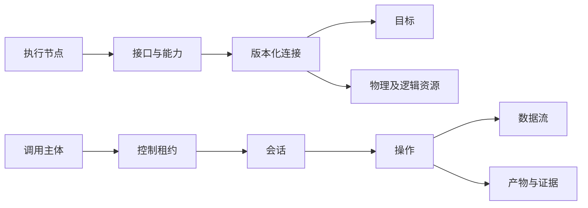

# 领域对象与关系

状态：建议基线 v0.3；对象名称为工作名称，字段尚未冻结。更新日期：2026-10-27。

## 对象定义

| 对象 | 职责与身份边界 |
| --- | --- |
| 节点 node | 可认证、可连接、可执行受支持能力的执行端；使用稳定身份，关联每次代理启动的运行标识 |
| 目标 target | 被开发、烧录、控制或观察的对象；可以是节点自身，也可以是外接设备 |
| 接口 interface | 节点暴露的硬件或软件接口；包含驱动、参数边界和资源需求 |
| 能力 capability | 一个可调用动作或可建立的数据通道及其契约、约束、副作用与验证能力 |
| 连接 connection | 接口、目标和物理路径的具体绑定；有版本，包含部署接线及必要参数 |
| 资源 resource | 会被占用、共享或产生冲突的实体，例如 GPIO、控制器、总线、复位线、电源或应用占用的外设 |
| 租约 lease | 一段有期限、带控制权版本的授权；不是实际调度锁的同义词 |
| 会话 session | 持续使用能力的上下文，例如串口或调试器连接；关联租约和配置快照 |
| 操作 operation | 一次有身份、期限、生命周期、执行记录与结果的操作 |
| 数据流 stream | 有序产生、可订阅的数据；消费者各持游标，不互相抢走数据 |
| 产物 artifact | 可持久引用的大块数据及元数据，例如固件、原始波形、日志片段、符号和转储 |
| 主体 principal | 人类、AI 或自动化客户端的可审计身份；能力由授权范围决定 |

节点与目标可以对应同一块实体硬件，但应保留各自职责及显式关联，避免注册、重启或烧录时出现两个互不关联的身份。

## 关系示意

示意图不要求每个操作都先创建用户可见会话。有限操作可以内部申请短期上下文；长期通道需要显式生命周期。

## 身份与配置

- 稳定 ID 用于引用，名称及分组用于显示和检索；别名不充当不可变身份。
- MAC、USB 序列号等是识别依据，不应成为公共业务逻辑的固定分支。
- 节点身份、代理运行标识、目标身份和连接版本分别记录。
- 板卡描述表达硬件约束；连接配置表达具体部署；运行时报告表达此刻状态。
- 操作接受时冻结解析后的节点、目标、接口和连接版本，不能执行过程中重新解析可变别名。

## 有效能力

有效能力是硬件能力、固件实现、板卡约束、连接配置、当前资源状态与调用者权限的交集。

能力描述需要表达输入与结果结构、单位、组合约束、资源需求、时限、缓冲边界、副作用、取消行为、重试规则和可提供的证据。它不应只有 `supports_i2c` 这样的布尔标记。

配置声明、设备识别、运行报告和实际测量应保留来源。例如配置中声明 3.3 V，不等于设备已经测量电压。

服务端负责规划和预检查，节点在执行前进行最终检查。客户端缓存的能力不能越过节点检查。

## 三个推演场景

本轮候选行为和异常路径见 [三场景推演](06-scenario-walkthroughs.md)，下面保留对象与评审问题总览。

| 场景 | 核心对象 | 下一轮必须回答 |
| --- | --- | --- |
| UART 常开 | 接口、租约、会话、收发操作、数据流、多个消费者游标 | 谁可以写，谁可以读，断联与缓冲溢出怎样记录 |
| I²C 事务 | 主机接口、外接目标、总线连接、有限操作 | 如何调度共享总线，读取副作用如何声明，ACK 代表什么 |
| 目标烧录 | 目标、烧录接口、固件及符号产物、长操作、复位与电源资源 | 如何识别目标、校验兼容性、取消、恢复并确认运行结果 |

这三个场景用于检验统一模型，不将现有双板接线提升为系统级角色。
